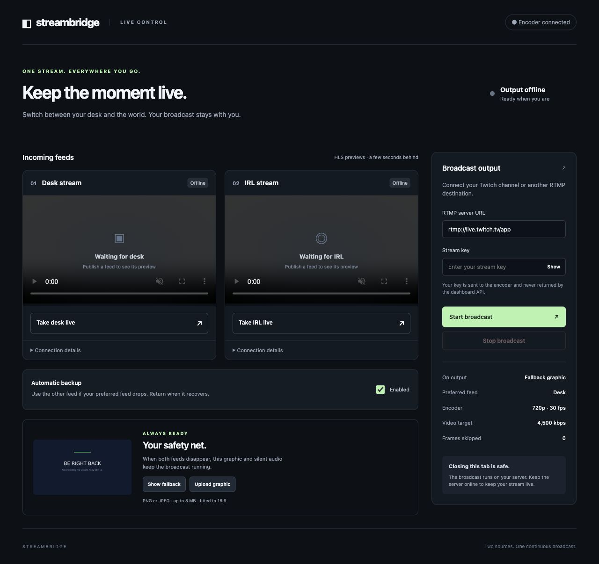
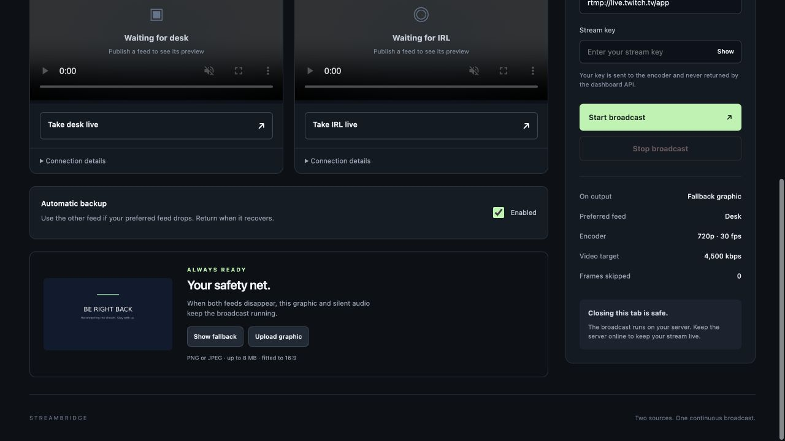
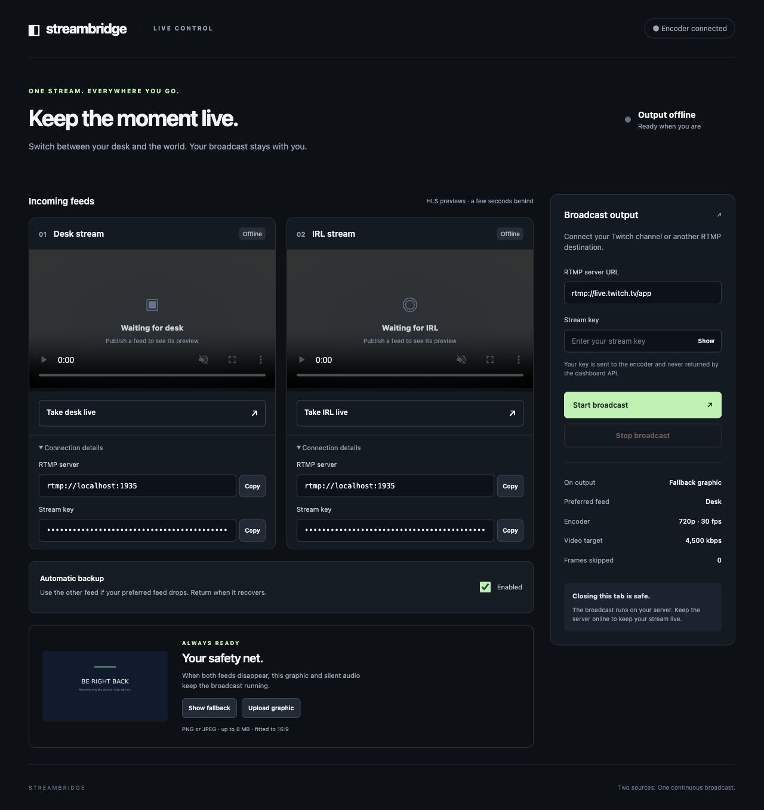
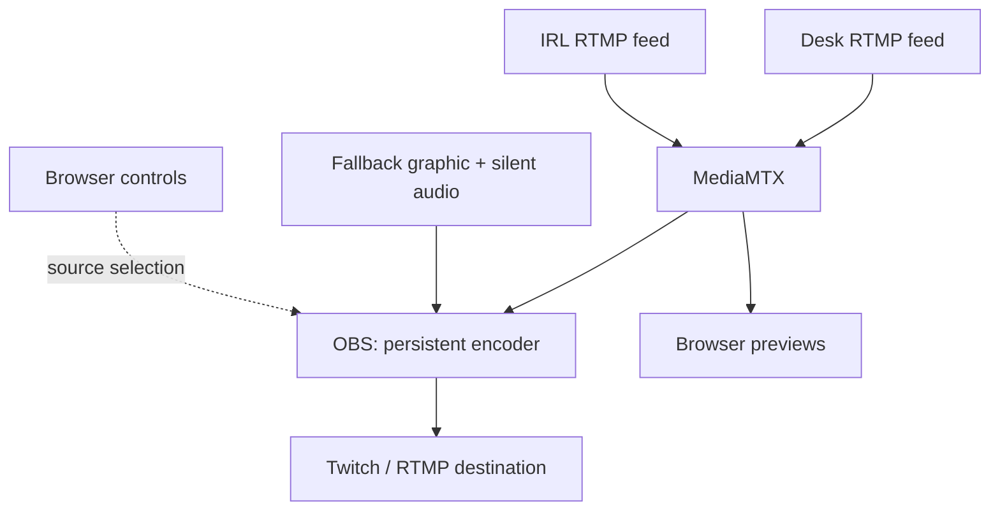

<div align="center">

# Streambridge

### Two feeds. One continuous broadcast.

Switch between your desk and IRL streams from a browser—with automatic backup and a fallback graphic that keeps your output running when both inputs disappear.


[Quick start](#quick-start) · [Screenshots](#screenshots) · [Server deployment](#server-deployment) · [Migration](#backups-and-migration) · [Testing](#testing)

</div>



## What it does

Send one feed from OBS at your desk and another from an IRL streaming app to your server. Streambridge decodes both, switches the program picture, and sends **one persistent RTMP/RTMPS output** to Twitch or another compatible destination.

| Feature | What you get |
| --- | --- |
| **Two incoming feeds** | Separate authenticated publishing details for desk and IRL. |
| **Browser previews** | Watch both incoming feeds and check their health. |
| **Manual switching** | Choose a preferred feed without restarting the output encoder. |
| **Automatic backup** | Use the other healthy feed when the preferred one drops, then return when it recovers. |
| **Always-available fallback** | A graphic and silent audio replace missing inputs while the output stays running. |
| **Your own graphic** | Upload a PNG or JPEG, fitted to a 16:9 canvas. |
| **Destination settings in the UI** | Enter your own RTMP/RTMPS server URL and stream key. |
| **Server-side operation** | Closing the dashboard does not stop your broadcast. |

> **Designed for one operator and one broadcast.** Keep the relay server online while you move between desk and IRL. Fallback handles input loss; it cannot preserve a connection through a relay-server outage or a destination-platform failure.

## Screenshots

### The control room

Two feed previews, source controls, automatic backup, and the outgoing destination in one dashboard. Previews are delayed by a few seconds; they are not frame-accurate monitors of the outgoing cut.


### Your safety net

Force the fallback graphic at any time, or let it take over automatically. Upload a replacement from the same panel.



### Connect your publishing devices

Expand **Connection details** under either feed to copy its RTMP server and full publishing key. Publishing credentials are masked in the interface.



## Quick start

### 1. Install the host requirements

- **Docker Engine + Docker Compose v2** on a Linux server, or Docker Desktop for local use.
- **Python 3.9+** on the host to generate the private configuration and run the optional test tools.
- **Git** to clone this repository.
- Internet access for the initial image build.

Use Docker's official [Engine installation](https://docs.docker.com/engine/install/) and [Compose installation](https://docs.docker.com/compose/install/) instructions. Python packages, OBS, FFmpeg, and MediaMTX run inside Docker; you do not need to install those separately on the host.

**Starting hardware target:** 4 modern CPU cores and 4 GB RAM. The relay uses software decoding/encoding; benchmark your host before a long broadcast. Allow upload bandwidth for 4.5 Mbps video, audio, and network overhead, in addition to the bandwidth needed for any remote previews. The incoming feeds also consume server download bandwidth.

### 2. Clone and configure

```sh
git clone https://github.com/ashongit-dev/streambridge.git
cd streambridge
cp .env.example .env
```

Generate two different random passwords:

```sh
openssl rand -hex 24
openssl rand -hex 24
```

Edit `.env` with your own values:

```dotenv
ADMIN_PASSWORD=YOUR_FIRST_RANDOM_HEX_PASSWORD
INGEST_PASSWORD=YOUR_SECOND_RANDOM_HEX_PASSWORD
PUBLIC_RTMP_URL=rtmp://YOUR-SERVER-IP:1935
WEB_BIND=127.0.0.1
```

| Variable | Purpose |
| --- | --- |
| `ADMIN_PASSWORD` | Password for the dashboard's `admin` account. Use at least 16 characters. |
| `INGEST_PASSWORD` | Password used by publishing devices and internal media readers. Use at least 16 characters. |
| `PUBLIC_RTMP_URL` | The RTMP server address your desk/phone can reach. Use `rtmp://localhost:1935` only for devices on this same computer. |
| `WEB_BIND` | Interface to which the dashboard is bound. Keep `127.0.0.1` when using an SSH tunnel or a reverse proxy on the host. |

Use unquoted hexadecimal passwords as shown. The configuration generator and test-feed Compose commands expect this `.env` format. Keep `.env` private.

### 3. Generate the media configuration and start

```sh
python3 configure.py
docker compose up -d --build
docker compose ps
```

`configure.py` creates `.runtime/mediamtx.yml` with the configured publishing/read permissions. It is deliberately separate from the checked-in template and is ignored by Git.

The first build installs dependencies and downloads HLS.js into the image. There is no public-CDN dependency during normal operation.

### 4. Open the dashboard

Open **[http://localhost:8080](http://localhost:8080)** and sign in:

- **Username:** `admin`
- **Password:** your `ADMIN_PASSWORD`

For a remote server, follow [Server deployment](#server-deployment) to reach this localhost-bound dashboard.

### 5. Connect desk and IRL

For each feed, expand **Connection details** and copy its **RTMP server** and **Stream key** into your publishing app's custom RTMP settings.

| Publishing setting | Recommended input |
| --- | --- |
| Video codec | H.264 |
| Audio codec | AAC |
| Resolution / frame rate | 1280 × 720 at 30 fps |
| Keyframe interval | 2 seconds |
| RTMP server | The server shown under that feed's connection details |
| Stream key | The complete key shown for that feed, including `?user=…&pass=…` |

Desk and IRL keys are different. If an app uses a single RTMP URL field, join the server, `/`, and the complete key. Each feed should contain a video track. The server fits incoming video to its 1280 × 720 output canvas while preserving aspect ratio.

### 6. Start your destination once

In **Broadcast output**, enter the destination's server URL and stream key, then choose **Start broadcast**.

Use **Take desk live** and **Take IRL live** to switch the preferred source. Leave **Automatic backup** enabled if you want the other feed to take over during a failure. You can start with no incoming feeds: the fallback graphic is sent until a source is healthy.

**Stop broadcast** ends the outgoing stream. Changing destinations requires stopping the existing output first. Closing the browser leaves the server running.

## Server deployment

### Reach the dashboard privately

For access from your computer, open an SSH tunnel:

```sh
ssh -L 8080:127.0.0.1:8080 user@YOUR-SERVER-IP
```

Leave that terminal open, then visit **http://localhost:8080** locally. A trusted VPN is another option, including when controlling the stream from a phone.

For access through a domain, place an HTTPS reverse proxy in front of the dashboard. An example for **Caddy installed on the same host** is provided at [`docs/deployment/Caddyfile.example`](docs/deployment/Caddyfile.example). Point the domain at your server and configure ports 80/443 for the proxy. Keep the app on `127.0.0.1:8080`, preserve the `Authorization` header, and disable proxy caching for the dashboard/API/previews. Use rate limiting appropriate to an internet-facing login.

### Ports

| Port | Reachability | Purpose |
| --- | --- | --- |
| **1935/TCP** | Reachable from publishing devices | RTMP ingest for desk and IRL. |
| **8080/TCP** | Localhost by default | Dashboard; reach through SSH, VPN, or an HTTPS reverse proxy. |
| **80/443 TCP** | Optional; reverse proxy only | Domain-based HTTPS access. |
| 8554, 8888, 9997, 4455 | Internal Docker services | RTSP, HLS, MediaMTX API, and OBS control. Do not publish these. |

Plain RTMP is not encrypted. Use a private network/VPN when the incoming feed or publishing credentials need transport confidentiality. Dashboard Basic authentication must use HTTPS or a trusted tunnel outside localhost. Publishing and internal media/API calls are authenticated.

### Output defaults

| Setting | Default |
| --- | --- |
| Canvas / output | 1280 × 720 |
| Frame rate | 30 fps |
| Video encoder | x264, `veryfast` preset |
| Video bitrate target | 4,500 kbps |
| Audio bitrate target | 160 kbps |
| Scene switching | Direct cuts |
| Fallback upload | PNG/JPEG, up to 8 MB and 20 megapixels |

## How switching works

| Condition | What goes to the destination |
| --- | --- |
| Preferred feed is healthy | Preferred feed. |
| Preferred feed fails; backup enabled and other feed healthy | Other feed. |
| Preferred feed fails; backup disabled | Fallback graphic. |
| Both feeds fail | Fallback graphic and silent audio. |
| Preferred feed recovers | Preferred feed after two healthy seconds. |
| **Show fallback** is selected | Fallback until another source is selected, even if both feeds return. |

The supervisor polls once per second. A disconnected publisher fails on the next successful check. A connected feed with no new bytes is treated as stalled after four seconds. The OBS decoder must also report playing. Brief freezes are therefore possible before takeover.

This checks transport/decoder health, not the visual content of a camera that continues transmitting a frozen picture.



MediaMTX accepts the publishers and creates HLS previews. OBS runs on a virtual display and keeps the outgoing encoder alive. Flask/Gunicorn serve the UI, proxy authenticated previews, and supervise routing through OBS's websocket API. Run one Gunicorn worker: the controller owns one OBS instance.

## Daily operation

Run these commands from the project folder:

| Task | Command |
| --- | --- |
| Start existing containers | `docker compose up -d` |
| Check services | `docker compose ps` |
| Read service logs | `docker compose logs --tail=100 relay media` |
| Follow logs | `docker compose logs -f relay media` |
| Stop containers, keep data | `docker compose stop` |
| Stop/remove containers and network, keep data | `docker compose down` |

To update:

```sh
git pull --ff-only
python3 configure.py
docker compose up -d --build
```

Schedule updates/restarts between broadcasts. A restart interrupts the outgoing connection. If a broadcast was running before an unexpected controller/server restart, the supervisor attempts to resume it; whether that remains the same broadcast is determined by the destination platform.

## Backups and migration

**The repository is the application; the Docker volume is your saved state.** Cloning this repository does not copy your existing fallback graphic, OBS profile, output key, or routing state.

### Fresh server

Install Docker/Compose and Python 3, clone into a folder named `streambridge`, create a new `.env`, set the new server's `PUBLIC_RTMP_URL`, then run:

```sh
python3 configure.py
docker compose up -d --build
```

Enter your destination details and upload your graphic again. Update the publishing devices to use the new server.

### Move your existing saved state

First use **Stop broadcast** in the dashboard. On the old server:

```sh
mkdir -p backups
docker compose stop relay
docker compose run --rm --no-deps --entrypoint sh \
  -v "$PWD/backups:/backup" relay \
  -c 'umask 077; tar -czf /backup/relay-data.tar.gz -C /data .'
```

Copy `backups/relay-data.tar.gz` and, if retaining your existing publishing credentials, `.env` securely to the new server. Keep the same project folder name (`streambridge`) or explicitly manage the Compose project name so the intended volume is selected. Change `PUBLIC_RTMP_URL` for the new server.

On the new server, with the backup in `backups/` and a fresh destination volume:

```sh
python3 configure.py
docker compose build relay
docker compose run --rm --no-deps --entrypoint sh \
  -v "$PWD/backups:/backup:ro" relay \
  -c 'tar -xzf /backup/relay-data.tar.gz -C /data'
docker compose up -d
```

The old server's relay remains stopped after the backup. Start it again only if you are continuing to use it. Docker's [volume documentation](https://docs.docker.com/engine/storage/volumes/) explains the underlying backup/restore behavior.

> Backups include stored output credentials. Keep them private. `docker compose down` preserves named volumes; adding **`-v` deletes them**.

## Testing

### Unit and API tests

With the image built and `.env` configured:

```sh
docker compose run --rm --no-deps --entrypoint python \
  -v "$PWD/tests:/app/tests:ro" relay \
  -m unittest discover -s tests -v
```

Or run on a host with Python 3.12 and the development dependencies:

```sh
python3 -m venv .venv
. .venv/bin/activate
pip install -r requirements.txt
python -m unittest discover -s tests -v
```

The API tests use a temporary data directory and an OBS double. They do not start a real output.

### Local acceptance test

With no real publishers or broadcast active:

```sh
python3 tools/acceptance.py
```

This builds the image, checks authentication, starts two synthetic feeds and a private RTMP receiver, tests previews/switching/failover/recovery, then stops the test output and publishers. It replaces the outgoing destination with the private receiver; enter your real destination again afterward. Results are saved under `test-results/`.

### Live Twitch test

Start the intended **test account's** broadcast in the dashboard, then run:

```sh
python3 tools/twitch_test.py
```

This publicly broadcasts a timed red/blue source sequence to the already-configured Twitch destination, simulates feed loss, checks backend continuity, and stops the broadcast at completion. It never reads or changes the outgoing stream key. Watch the channel separately to verify received playback. Do not run it during a production broadcast.

### Verified behavior

The included records document:

- **21 passing unit/configuration/API tests.**
- **30 passing local acceptance checkpoints**, including one receiver RTMP connection surviving every source change.
- **Eight live Twitch stages over approximately six minutes**, with 183 backend samples, no observed encoder reconnects or counter resets, and zero reported encoder skipped frames.
- Visual confirmation of the expected Twitch pictures and browser preview playback; output and test publishers stopped cleanly.

These are synthetic-feed results, not a long-duration soak or real cellular-network test. The Twitch player was muted during visual checks; listening quality was not assessed. See [`validation/`](validation/) for machine-readable records and [the validation notes](docs/VALIDATION.md) for detail.

## Troubleshooting

| Symptom | Check |
| --- | --- |
| Dashboard is unreachable | Run `docker compose ps`; confirm Docker is running. For a remote server, use the SSH tunnel or reverse proxy. |
| Encoder keeps reconnecting | Read `docker compose logs relay`; inspect `/data/obs.log` inside the relay container privately. Check available RAM and software OpenGL initialization. |
| Device cannot publish | Confirm TCP 1935 is reachable, `PUBLIC_RTMP_URL` is correct, and the complete publishing key was copied. `localhost` on a phone refers to the phone itself. |
| Feed stays unhealthy | Check H.264 video/AAC audio and that OBS can decode the video. A connected publisher alone is not sufficient. |
| Preview does not play | Use a current browser with HLS/MSE support, allow playback, and check HTTPS/proxy routing. Preview delay is expected. |
| API or ingest authentication fails after changing a password | Rerun `python3 configure.py`, restart the media service, and restart relay so internal readers use the new credentials. |
| Output is retrying | Verify the destination server/key and the relay's outbound connectivity. Changing destination requires stopping the current output first. |
| Tests cannot access Docker | Run the test from a terminal/user that can use the Docker daemon. A sandboxed automation session may not have socket access. |

Diagnostic helper:

```sh
python3 tools/diagnose.py
```

Reports are saved under `test-results/`. Treat diagnostics as private: OBS logs can contain destination and input details.

## Security and scope

- One administrator account, one pair of feeds, and one outgoing broadcast.
- Dashboard, ingest, and media/API credentials are protected; the outgoing key is never returned by the dashboard API.
- The named `relay-data` volume contains output credentials and OBS logs. Restrict access to it.
- `.env`, `.runtime/`, backups, logs, and generated test results are excluded from Git. Inspect files before sharing diagnostics.
- The OBS control socket is unauthenticated inside the isolated Compose network. Keep that network private and do not expose port 4455.
- Fallback protects the output during input loss. Server failure, output-network loss, and platform outages can still end a broadcast.

## Built with

[OBS Studio](https://github.com/obsproject/obs-studio) · [MediaMTX](https://github.com/bluenviron/mediamtx) · [Flask](https://flask.palletsprojects.com/) · [Gunicorn](https://gunicorn.org/) · [HLS.js](https://github.com/video-dev/hls.js)

Third-party projects retain their own licenses. The HLS.js license is downloaded alongside its browser asset during the image build.
